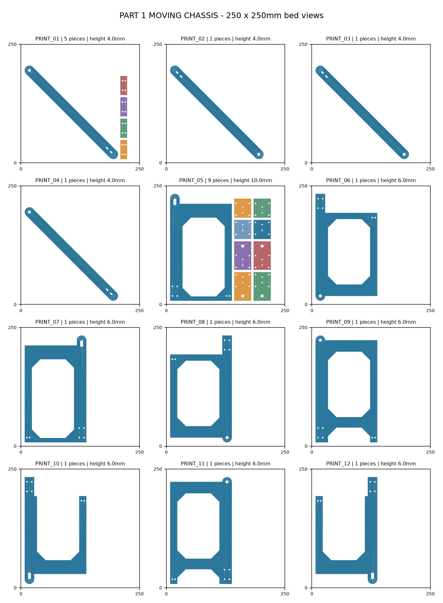
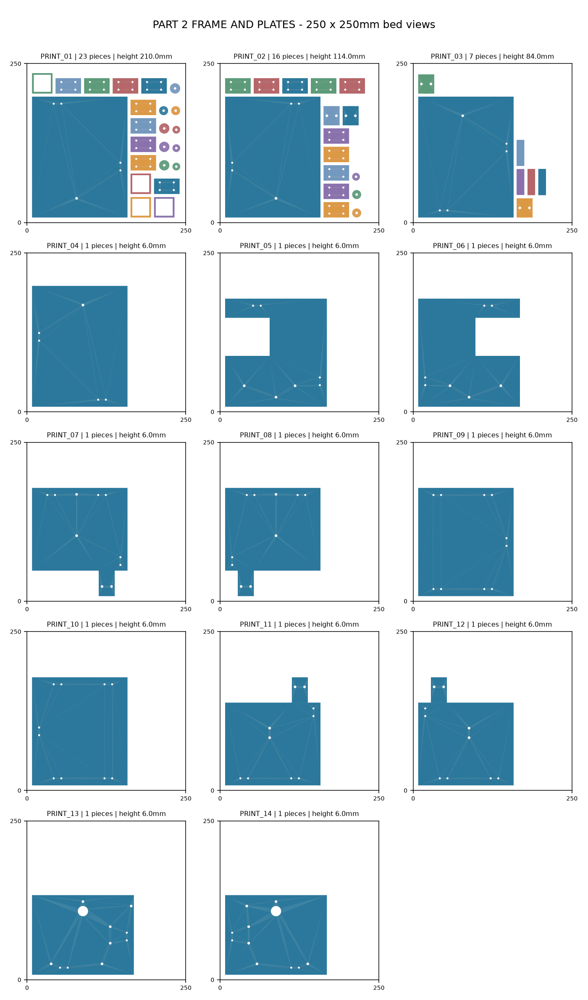
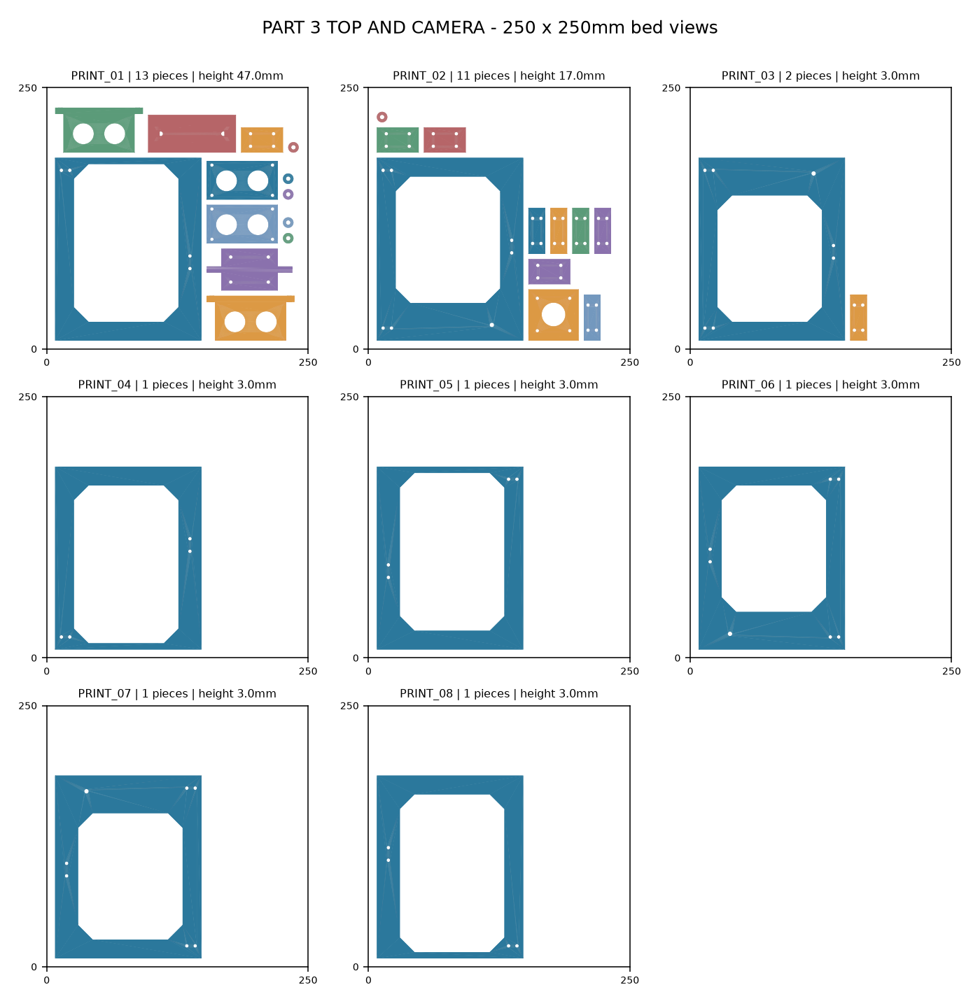

# Parts to print

Full-scale, arranged print batches for the Anycubic Kobra S1, prepared from `seee1.step`.

Leg modules, wheels, and the telescope stages, guides, and rotary links already printed are excluded. Real motors, bearings, pins, fasteners, electronics, and the camera are hardware items rather than printable replacements.

| Batch | Download | Arranged print beds | Contents |
| --- | --- | ---: | --- |
| 1 | [Moving chassis ZIP](PART_1_MOVING_CHASSIS.zip) | 12 | Arms, end brackets/caps, integrated hex-link halves, and joining strips |
| 2 | [Frame and plates ZIP](PART_2_FRAME_AND_PLATES.zip) | 14 | Fixed supports/rails, base/middle/deck sections, and joining strips |
| 3 | [Top and camera ZIP](PART_3_TOP_AND_CAMERA.zip) | 8 | Uppermost platform sections/strips, camera yoke/cradle, and accessory mounts |

## How to print

1. Download and unzip a batch, or open its matching folder below.
2. Open `PRINT_THESE/PRINT_01.stl` in Anycubic Slicer Next with the Kobra S1 profile.
3. Keep millimetres and **100% scale**. The parts are already arranged; each STL is one bed.
4. Follow that batch's `START_HERE.txt` for material, walls, infill, supports, and assembly. Inspect the sliced layer/support preview, then export your printer's toolpath.
5. Print each numbered STL once, continuing with `PRINT_02.stl`, etc. Use `PRINT_CHECKLIST.csv` to track the beds. Do not print the ZIP and folder contents as separate sets.

The three batches contain **34 regular bed layouts**, not three physical prints. Batch 2 also has two `CHECK_IF_ALREADY_PRINTED` bed files containing fixed mount/guide-related parts: print those only if missing from the existing telescope assembly.

## Layout previews

### Batch 1

### Batch 2

### Batch 3

## Prototype joints and verification

Oversized links and plates have new lap/splice joints that require metal fasteners. These three batches require 148 new M3 bolt/nut sets for the new joints, plus the original assembly hardware. Verify lengths, washers, engagement, and protrusion on one joint first; details are in the batch guides. Four modeled follower sleeves have only 0.1 mm walls and do not have printable substitutes here.

The integrated hex links in Batch 1 fuse the original touching bar/flange geometry before splitting and supersede the earlier separate bar/frame exports. Use these updated batches consistently.

The meshes were checked for watertightness, winding, connected-part counts, arrangement clearance, and printer envelope. The new hex halves were checked to reconstruct the original fused shape apart from their new fastener holes. No slicing run, physical fit test, load validation, FEA, or dynamic interference simulation was performed.

**Dry-fit one corner and one bolted plate joint before batch printing.** Check clearance of strips, bolt heads, and nuts throughout the travel. Begin unloaded and move by hand; stop if the mechanism binds, joints slip, or parts flex or crack.
